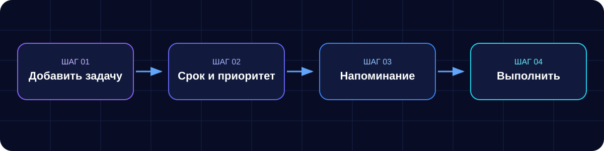

# CODE 404 · Помощник по планированию дня

**Командный проект РГРТУ · Введение в профессиональную деятельность · 2026**

[Документация](docs/README.md) · [Практические работы](practical-works/README.md) · [Командные роли](docs/roles-and-responsibilities.md) · [Правила работы](docs/team-contract.md)

  

---

## ✦ О проекте

«Помощник по планированию дня» — концепция цифрового продукта для записи задач, распределения дел по времени, установки приоритетов и напоминаний. Цель — помочь пользователю организовать повседневные дела и снизить риск забыть о важных задачах.

> **Текущий статус:** в репозитории представлены командная документация и материалы практических работ. Полноценная реализация приложения, автоматические тесты и инструкция по запуску пока не представлены. Визуальные материалы ниже показывают концепцию, а не готовый интерфейс работающего продукта.

## ◈ Как предполагается использовать продукт

## ✧ Основные идеи

| 
📅 Планирование
 | 
🎯 Приоритеты
 | 
🔔 Напоминания
 | 
✓ Выполнение
 |
|---|---|---|---|
| Список задач на день и ближайшие дни | Понимание, что важнее сделать сначала | Снижение риска пропустить срок | Наглядное отслеживание прогресса |

*Это планируемые возможности продукта; они не означают, что соответствующие функции уже реализованы.*

## 👥 Команда CODE 404

| Участник | Роль в проекте |
|---|---|
| Жихорев Дмитрий Николаевич | Лидер, менеджер проекта |
| Ильин Петр Валерьевич | Дизайнер |
| Зоткин Алексей Артемович | Программист |
| Гужавин Александр Александрович | Тестировщик |
| Шувалов Арсений Александрович | Архитектор ПО |

## 🧭 Навигация по репозиторию

- **[Документация команды](docs/README.md)** — договорённости, роли, RACI и аудит репозитория.
- **[Практические работы](practical-works/README.md)** — индекс отчётов и материалы по дисциплине.
- **[Матрица RACI](docs/raci-matrix.md)** — распределение ответственности.
- **[Скрипты](scripts/README.md)** — состояние и назначение каталога скриптов.
- **[Как внести изменения](#-как-внести-изменения)** — порядок командной работы.

## 🎓 Практические работы

| Работа | Тема / материалы |
|---|---|
| № 1 | [Отчёт Word](practical-works/practical-work-01/VvPD_otchet_3_brigada_sr1.docx) · [страница работы](practical-works/practical-work-01/report.md) |
| № 2 | [Отчёт Word](practical-works/practical-work-02/VvPD_otchet_2.docx) · [страница работы](practical-works/practical-work-02/report.md) |
| № 3 | [Определение целевой аудитории](practical-works/practical-work-03/report.md) · [отчёт Word](practical-works/practical-work-03/VvPD_SR3_CODE404_FINAL.docx) |
| № 4–8 | [Индекс и шаблоны страниц](practical-works/README.md) |

## 🛠 Как внести изменения

1. Создайте отдельную ветку для своей задачи.
2. Внесите изменения в нужные файлы и проверьте ссылки.
3. Создайте Pull Request с кратким описанием изменений.
4. Попросите участника команды проверить изменения.
5. После согласования объедините Pull Request с основной веткой.

Подробности: [правила взаимодействия](docs/team-contract.md).

---

**CODE 404** · Планируем день. Освобождаем время для важного.

